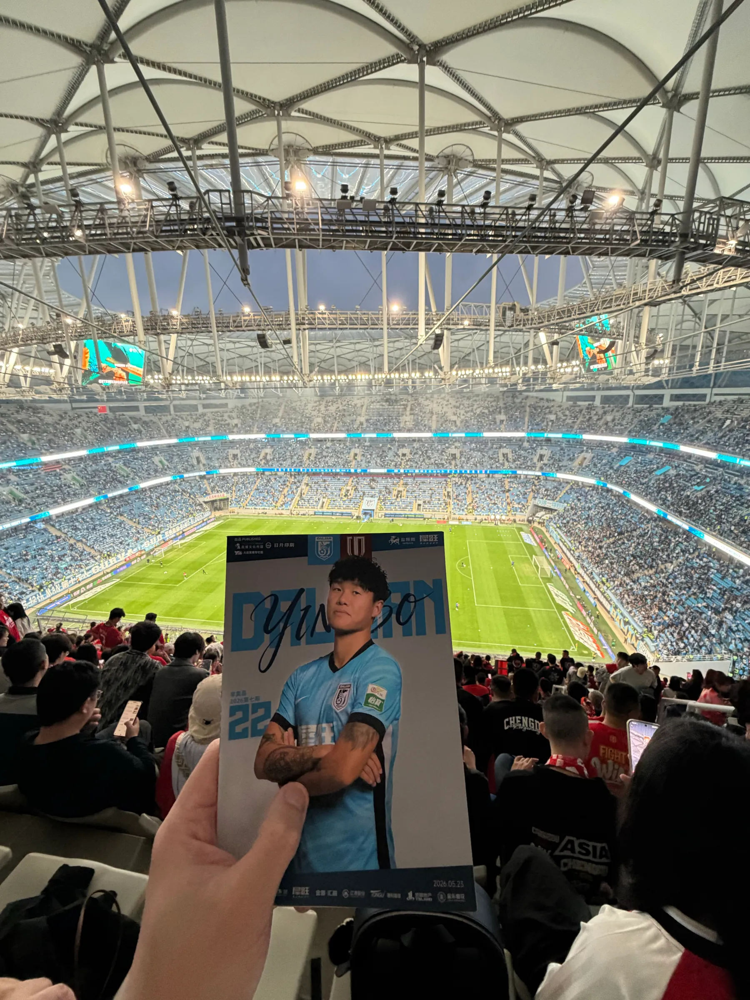

到大连以后第一次真正看见海，其实是在梭鱼湾球场外面的麦当劳门口。

那是五月下旬的傍晚，白天还能穿短袖，可拎着刚买的鸡块和可乐走出来时，风一吹，衣服贴在身上，又觉得套件卫衣也合适。海边的城市总是这样，温度很难用一个数字说清。海就在几步开外，近得能直接看清浪的形状。还没进场，空气里已经有了咸味——梭鱼湾这个名字，本来就是带着海的。

进了场，客队区却在极高的地方，高到几乎像被放在球场的山顶。台阶一层接一层往上延伸，爬到后来，腿比眼睛更先知道这个看台有多高。成都来的球迷聚在那一片，正对球员通道，离草坪很远，离天空反而很近。从最高层往下看，球员的跑动、看台的颜色、场边的灯光，都被压成一个巨大的平面。

只有声音是立体的。

我在凤凰山听过很大的声浪，成都的主场有自己的热度、秩序和爆发力；以前在工体看球，散客之间又常有一种自然的疏离，每个人都在看球，彼此却隔着一层都市生活的边界。但梭鱼湾那晚不太一样。大连这边像是一整片看台在共同呼吸，球迷协会的声音大，散客的声音也大，很多人跟着唱、跟着喊，把这场比赛过成一件属于自己的事。也许是客队区实在太高，也许是球场的结构把声浪推向了最上层，主队进球的时候，呐喊从四面八方卷上来，直接穿过耳膜。那一刻的欢呼几乎带着金属感，明亮、尖锐、密集，像一阵风从海面上刮过来，撞进球场里。

而在那片有些刺耳的欢呼底下，我还听见了远处港口传来的汽笛声。那声音很沉、很低，像是从海面和夜色深处压过来的，和球场里的声浪混在一起：一边是几万人同时爆发的呐喊，一边是货轮缓慢而厚重的回应。

跟着汽笛一起渗进来的，还有海风的气味。那是一种极淡的、带着潮湿凉意的腥气，在漫天的喧嚣里悄无声息地漫过球场边缘，随着每一次呼吸钻进肺里。眼前的灯光、草坪、鼓声和旗帜把看台填得满满当当，连情绪都被无限放大；可这丝气味却让人瞬间有一点抽离，提醒着我，在球场之外，旁边还有一片更大的水域。

那晚的比分最后停在二比零，大连赢了。客场输球，人很容易在四周的欢呼里陷入一种震耳欲聋的沉默。身边都是同样从远处赶来的人，穿相似的颜色，唱过熟悉得不能再熟悉的歌，最后在同一个时刻安静地看着记分牌，任凭失望一点点降落在嗓子里。好在这座城市的气味并不带任何情绪，比赛总有输赢，它只是安静地待在那里，随着一呼一吸，把这一晚牢牢留在了身体里。

终场哨响的时候，港口的汽笛又一次低低地传了过来。许多主队球迷把软坐垫抛向空中，无数个坐垫几乎同时飞起来，又落下去，在灯光下短暂地离开看台，像一群轻飘飘的鸟，最后散落在草坪边、通道旁和座椅之间。那一幕有点震撼，也有点可爱，很像民间球场自己长出来的庆祝方式：所有人都知道比赛结束了，所有人也都还舍不得走。

就在这片迟迟不肯散去的热闹里，全场唱起了《大海啊故乡》。这首歌出现在大连的球场里，几乎有一种命中注定的合适。在这座常年与港口、船只、迁徙和归来相伴的城市里，海从来都不只是风景，也是生活本身的方向。旋律响起来时，刚才还锋利的声浪忽然变宽了，像从看台一路铺开，直接铺到了球场外的海面上。

顺着散场的人群缓慢往外走时，我手里一直攥着那条围巾。那是 2024 年 5 月在凤凰山的球迷商店买的，快两年了，颜色已经不那么新。它跟我去过很多次主场，也去过一些别的地方，赢球的时候举起来过，输球的时候就这么攥在手里。

走到昏暗的路灯下，一个穿蓝色球衣的大连小球迷迎面走了过来，大概五六年级的样子，脸上有一种很直接的期待。他先开口，声音很亮：

“哥哥，可以交换围巾吗？”

我几乎没有犹豫就答应了。看着他把那条旧围巾接过去，拿在手里翻来覆去地看，心里那点输球的低落，好像也跟着散掉了一些。我们在路灯下站着聊了一会儿，关于足球，关于成都，也关于大连。他说话毫不遮掩，开心就是开心，喜欢就是喜欢，高兴到想和一个远道而来的客队球迷换一条围巾。那种干净的热情，会让人突然想起看球最简单的一面：你支持你的球队，我支持我的球队，比赛结束以后，我们还可以站在同一盏路灯下说话。

那其实是个很短的瞬间，短到像散场人流里随时会被淹没的一句话。可递出去的时候我才觉得，交到他手里的也许还有别的东西：凤凰山、过去两年的很多场比赛，以及我作为成都球迷的一点私人记忆。大概也就是在那一刻，客场突然从一场失利，变成了我和另一座城市之间短暂的关系。

围巾留在了大连，手里空出来的那一点位置，好像正好被海风填上了。